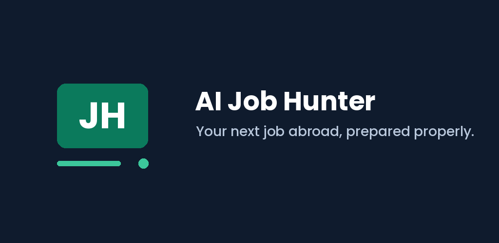
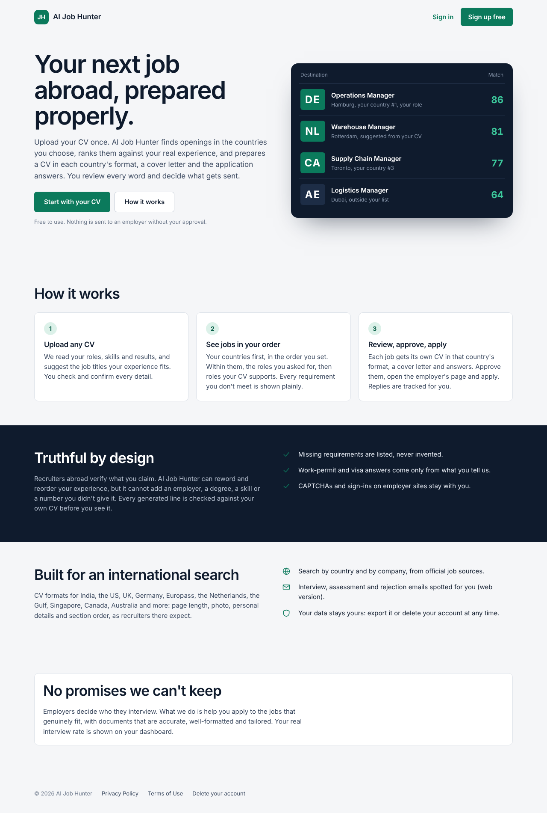
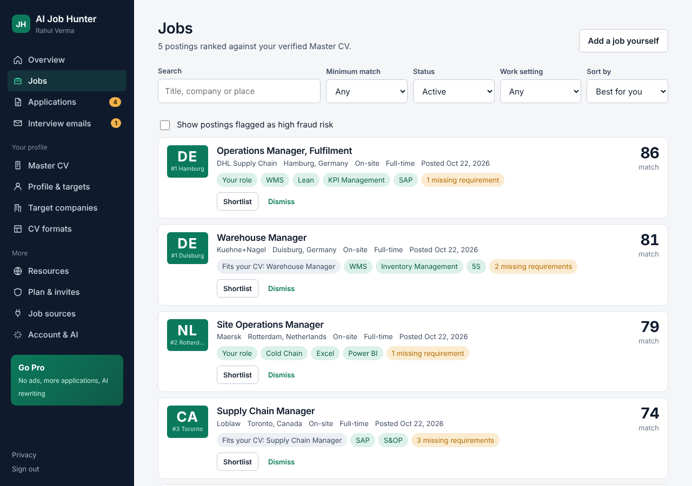
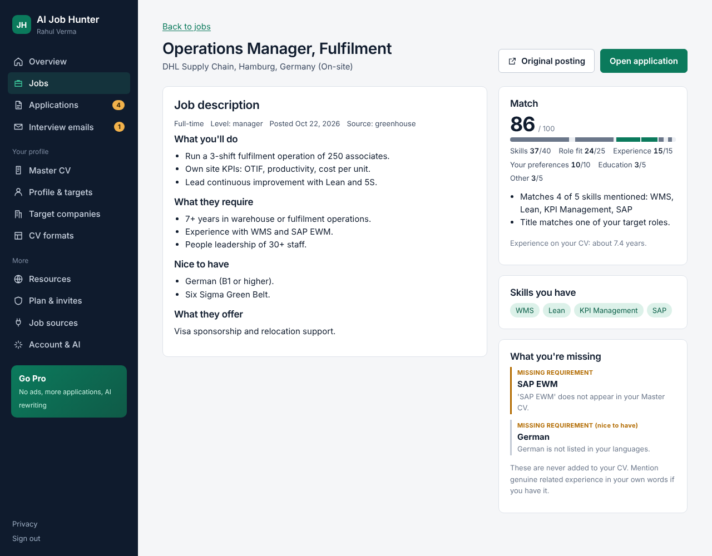
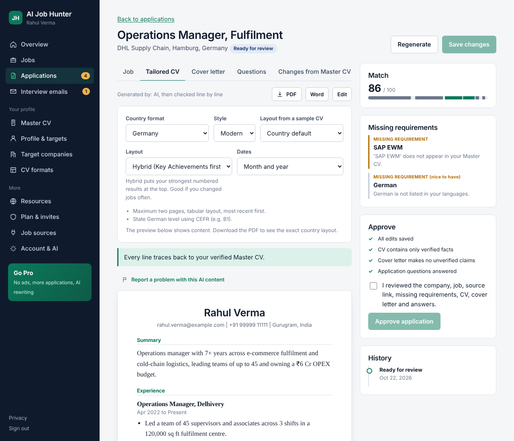
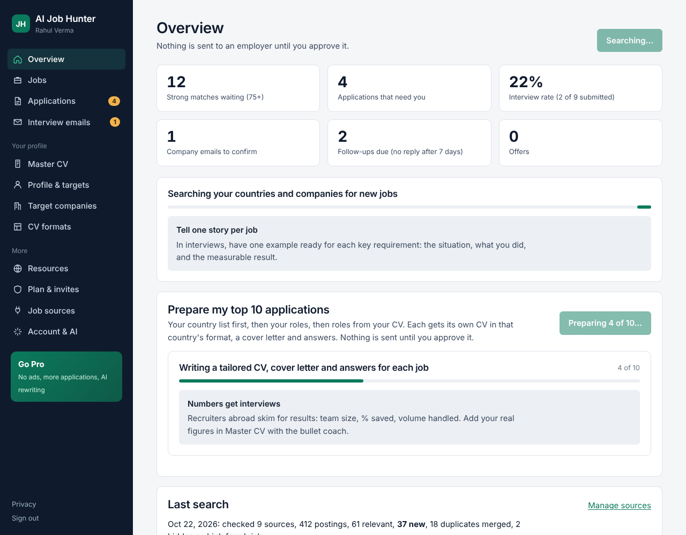
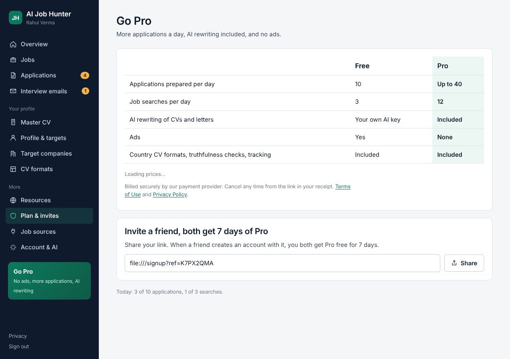
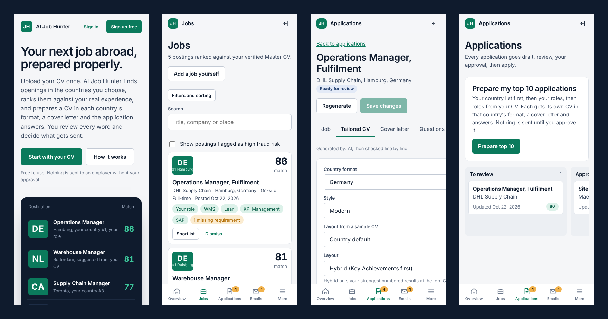
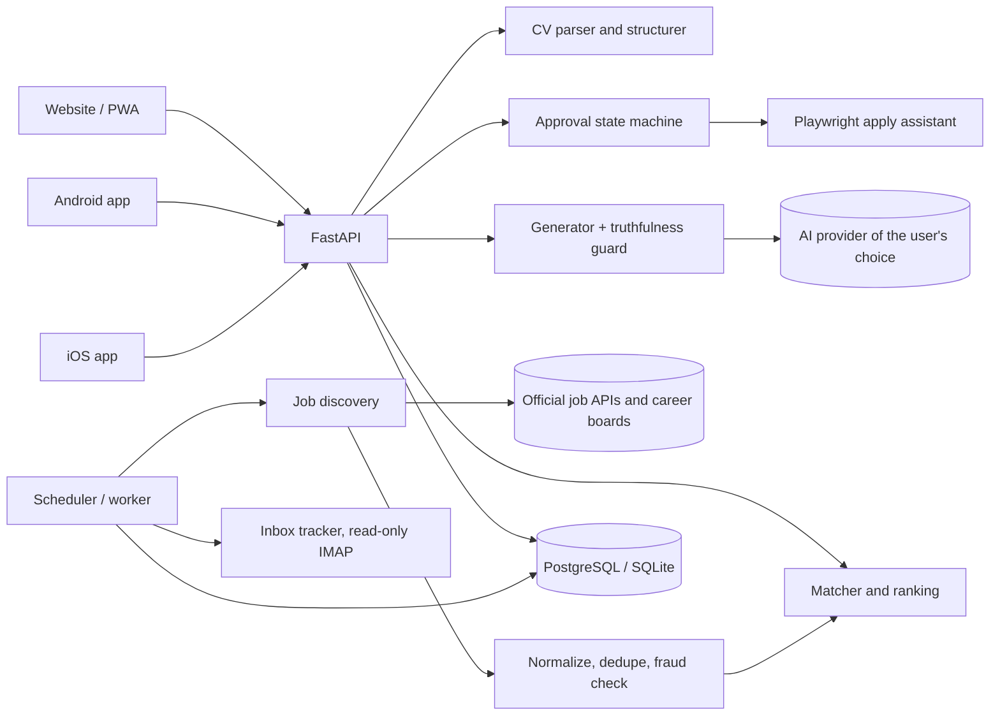

<p align="center">
  
</p>

<h1 align="center">AI Job Hunter</h1>

<p align="center">
  <b>Find jobs abroad that fit your real experience, and apply with a truthful CV in each country's format.</b><br>
  Web · Android · iOS from one TypeScript codebase, FastAPI backend, review-before-apply workflow.
</p>

<p align="center">
  
  
  
  
  
  
</p>

---

## The problem

Applying for jobs in another country is slow and easy to get wrong. Every country expects a different CV (a German Lebenslauf, a two-page UK CV, a Europass, a Gulf CV with nationality and visa status), job boards are full of weak matches and scams, and AI CV tools happily invent skills and numbers, which gets candidates rejected or blacklisted.

## What AI Job Hunter does

Upload any CV once. The app:

1. **Reads the CV** (PDF, DOCX, scanned PDF via OCR) into a structured Master CV that is stored permanently and never overwritten.
2. **Suggests roles** the experience fits, alongside the roles the user picks.
3. **Finds real openings** from official job APIs and employer career boards (Greenhouse, Lever, Ashby, Workable, SmartRecruiters, Adzuna, Jooble and more), in the user's preferred countries and target companies.
4. **Cleans the results**: normalises, removes duplicates, flags likely scams.
5. **Ranks every job** with an explainable score and lists each **MISSING REQUIREMENT** in plain words.
6. **Prepares a tailored application**: a CV in that country's format, a cover letter and answers to common questions.
7. **Checks every line against the Master CV** and removes anything the candidate cannot back up.
8. **Waits for approval**: DRAFT → REVIEW → USER APPROVAL → APPLY. Nothing is sent automatically.
9. **Tracks replies**: reads employer emails (read-only) and flags interviews, assessments, offers and rejections, with follow-up drafts and an interview-rate dashboard.

## Screenshots

| Landing page | Jobs ranked against your CV |
|---|---|
|  |  |
| **Job details, match and missing requirements** | **Review the tailored CV before approving** |
|  |  |
| **Overview dashboard** | **Plans** |
|  |  |

**On phones (Android and iOS apps share the same interface):**



## Engineering highlights

**A truthfulness guard that doesn't trust the AI.** Generated CVs, cover letters and answers go through a deterministic checker built from the verified Master CV (`backend/cv/truthfulness.py`). It catches invented employers, titles, degrees, certifications, skills, metrics, changed dates or locations, inflated years of experience, and work-authorization claims that don't hold in the target country. Flagged content is removed before the user sees it, and approval is blocked while any remains. The tests include a simulated AI that lies on purpose.

**Approval bound to exactly what was reviewed.** Approval stores a hash of the reviewed documents; any later edit revokes it. The Playwright apply assistant detects CAPTCHA, MFA, sign-in walls and bot checks and hands the page to the user instead of trying to get past them.

**Explainable matching.** A skill taxonomy with aliases (including logistics and supply-chain terms), required vs. preferred requirement extraction, and a weighted score (skills 40, role 25, experience 15, preferences 10, education 5, other 5). Dealbreakers cap the score, and every point is explained in the UI. Jobs are ordered by the user's country preference, then their chosen roles, then roles suggested from the CV, then by score.

**18 country CV formats × 3 styles.** India, US, UK, Germany, Europass, Netherlands, UAE, Saudi Arabia, Qatar, Singapore, Canada, Australia, New Zealand, Ireland, Switzerland, France, Denmark and China, each with documented conventions (photo, date of birth, page limit, date style). Page limits are met only by leaving out the least relevant content, never by rewriting it. A sample CV's layout (section order, headings, length) can be learned while its text is thrown away.

**Senior-candidate tooling.** A strength check for 7+ years of experience (team size, P&L, savings, vendors, scale, KPIs), hybrid layout, grouping of internal promotions, contract labels, and an X-Y-Z bullet coach that leaves blanks for the user to fill with real numbers instead of making numbers up.

**One codebase, three platforms.** React + TypeScript, shipped as a website (PWA) and as Android and iOS apps with Capacitor 8 (native share sheet, in-app browser, local reminders, status bar and back-button handling).

**Built for store review.** In-app and web account deletion, data export, privacy policy and terms, a demo reviewer account script, a report button for AI content, App Tracking Transparency, Google UMP consent and minimal permissions. See [docs/PUBLISHING.md](docs/PUBLISHING.md).

**Monetization without hurting the product.** AdMob banners and rewarded ads in the apps and AdSense on the web, only on content screens and never on CV editing, approval or account screens. Pro subscription through RevenueCat, with the server verifying entitlements itself. Referral rewards and partner links. See [docs/MONETIZATION.md](docs/MONETIZATION.md).

**Security.** scrypt password hashing, JWT with token-version revocation, httpOnly cookies on the web and bearer tokens in the apps, Fernet-encrypted API keys and app passwords, rate limiting, an SSRF guard for URL imports, and single-use password-reset tokens.

## Architecture



## Tech stack

| Layer | Tools |
|---|---|
| Backend | Python, FastAPI, SQLModel / SQLAlchemy, Alembic, APScheduler, PyJWT, cryptography |
| Documents | pypdf, pypdfium2, python-docx, ReportLab, Tesseract OCR (pytesseract) |
| AI | Provider abstraction: OpenAI, Anthropic, Google Gemini, Ollama or any OpenAI-compatible API; works without AI too |
| Frontend | React, TypeScript, Vite, React Router, self-hosted Sora and Instrument Sans fonts, light and dark themes |
| Mobile | Capacitor 8 (Android API 36, iOS), AdMob, RevenueCat |
| Automation | Playwright |
| Deployment | Docker Compose (PostgreSQL, app, worker, Caddy with automatic HTTPS) |
| Tests | pytest: 60 tests covering parsing, matching, the truthfulness guard, safety rules and the API flow |

## Size

About 9,000 lines of Python and 4,000 lines of TypeScript.

---

# Using it

## Quick start on Windows (one click)

You need **Python 3.11+** (tick *Add python.exe to PATH* when installing) and **Node.js 20+**, both free.

1. Double-click **`Start AI Job Hunter.bat`** in this folder.
2. The first time, it installs everything (a few minutes) and puts an **AI Job Hunter** shortcut on your Desktop.
3. Your browser opens http://localhost:8000. Keep the black window open while you use the app; close it to stop.

Then:

- Upload **any CV** and click *Verify*. The app reads your job titles and skills and suggests roles that fit (you can switch any off).
- In *Profile & targets*, list your **countries in order of preference** and, optionally, the **roles you want first**.
- *Find jobs now*. Jobs are ordered: your countries first (in your order), within them your roles first, then roles suggested from your CV, then by match score.
- *Prepare top 10* drafts a tailored CV (in that country's format), cover letter and answers for the best ten. Review, approve, then *Fill the form for me* or apply yourself.

(Developers: `scripts\setup.ps1` and `scripts\dev.ps1` still work for hot-reload development.)

Free API keys worth adding to `.env`: `ADZUNA_APP_ID`/`ADZUNA_APP_KEY` (developer.adzuna.com) and `JOOBLE_API_KEY` (jooble.org/api/about). Without them, company search can only use public job boards. Edit `.env` with Notepad, then restart the app.

Optional: install [Tesseract OCR](https://github.com/UB-Mannheim/tesseract/wiki) to read scanned PDF CVs. macOS/Linux: `bash scripts/setup.sh` then `bash scripts/dev.sh`.

## AI is optional

With no AI configured the app still works: CV content is reordered by relevance (wording unchanged), cover letters use your own bullet points, and common questions are answered from your profile. To enable AI rewriting, open **AI settings** and pick OpenAI, Anthropic, Google Gemini, Ollama (free, local) or any OpenAI-compatible service, then enter the model name and key. Keys are stored encrypted. No vendor is hard-coded.

## Try the pipeline without running the app

```bash
python scripts/demo_pipeline.py
```

Scores the sample CV in `data/samples/` against a sample job and prints the match, missing requirements, tailored-CV guard result, cover letter and answers.

## Server deployment (Docker)

```bash
cp .env.example .env          # set SECRET_KEY, POSTGRES_PASSWORD, APP_ENV=production
docker compose up -d --build  # PostgreSQL + app (UI and API on :8000) + worker
```

Put a TLS reverse proxy (Caddy, nginx) in front for remote access. In Docker the browser runs headless, so "Fill the form for me" can't hand a visible window to you; use *I'll apply myself* there, or run the app locally for assisted applying.

## Tests

```bash
.venv\Scripts\python -m pytest        # Windows
.venv/bin/python -m pytest            # macOS/Linux
```

Covers CV parsing, matching, missing requirements, dedupe, fraud screening, the truthfulness guard (including a simulated AI that lies), approval gating, CAPTCHA/login detection, SSRF protection and a full API flow.

## Project layout

```
backend/
  api/            HTTP routes (auth, profile & CV, jobs & sources, applications, settings)
  models/         Database tables (SQLModel; SQLite in dev, PostgreSQL in prod)
  schemas/        Request/response models
  services/       Workflows: CV lifecycle, discovery pipeline, applications
  ai/             Provider abstraction + prompts + generation with deterministic fallbacks
  cv/             Parser (PDF/DOCX/OCR), structurer, renderer (PDF/DOCX), truthfulness guard
  jobs/           Normalizer, dedupe, fraud check, requirement extraction, matcher, scheduler
  applications/   State machine and approval rules
  integrations/   Greenhouse, Lever, Ashby, Workable, Remotive, Arbeitnow, Adzuna, RSS, manual/URL import
  automation/     Playwright apply assistant and blocker detection
  security/       Password hashing, tokens, secret encryption, rate limiting, SSRF guard
frontend/         React + TypeScript UI (Vite)
migrations/       Alembic
tests/  scripts/  docs/  data/
```

More detail: [docs/ARCHITECTURE.md](docs/ARCHITECTURE.md), [docs/SAFETY.md](docs/SAFETY.md), [docs/DECISIONS.md](docs/DECISIONS.md).

---

<sub>Built by <a href="https://github.com/aicareerversestartup-glitch">@aicareerversestartup-glitch</a>. Suggested GitHub topics: <code>fastapi</code> <code>react</code> <code>typescript</code> <code>capacitor</code> <code>playwright</code> <code>job-search</code> <code>resume</code> <code>ats</code> <code>ai</code> <code>career</code>.</sub>
